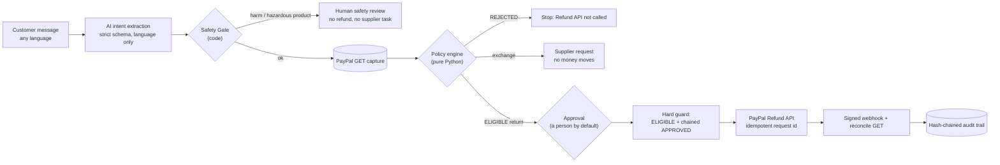

# TradeOS

[](https://github.com/Fu93/tradeos/actions/workflows/ci.yml) [](LICENSE) 

> **PayPal moves the money. TradeOS moves the work.**
>
> Use AI where language is ambiguous. Use code where money is at stake.

TradeOS is a post-purchase operations desk for small cross-border merchants. A customer writes *"the shoes are the wrong colour, I want my money back"* in any language; TradeOS reads it, checks it against the merchant's own return policy, gets an approval, issues the PayPal refund (or arranges a size exchange with no money moving), and keeps a tamper-evident record that PayPal confirmed it.

**Live demo:** https://tradeos-s33z.onrender.com (PayPal Sandbox, no real money)


## The problem

Small cross-border merchants cannot staff a full operations or customer-service team. A simple "can I swap size 42 for 43?" turns into minutes of manual work: read the message (often in another language), look up the order, check the return window, email the supplier, decide, and then go into PayPal to issue the refund. It is slow, and it is risky, because the person reading the message is also the person moving money.

TradeOS automates the *work* around the payment while keeping money movement deterministic, approved under the merchant's own rules and confirmed by PayPal. It is **not** a storefront, a shopping agent, or a chatbot that answers the customer.

## Try it in two minutes

1. Open the [live demo](https://tradeos-s33z.onrender.com) and click **Run Case A — eligible return (refund)**. This creates a real PayPal Sandbox order and capture.
2. Click **Approve & refund**. The Refund API is never called before this approval.
3. Read the evidence cards: the PayPal refund, the signed PayPal webhook, the reconciliation against PayPal, and the audit-chain badge.
4. Run **Case B** (the policy rejects it, Refund API calls = 0), or type your own message in Chinese, Spanish, German or Japanese.

## How it works



| Principle | Enforced in code, not in the prompt |
|---|---|
| **AI understands** | LLM output is validated against a strict schema; anything off-schema becomes `UNKNOWN` and goes to a person. The AI can add a "no", never remove one. |
| **Rules decide** | `app/policy.py` and `app/safety.py` are pure Python. A rejected case never calls the Refund API (asserted in tests). |
| **People approve** | The refund guard refuses unless the case's hash chain holds a policy `ELIGIBLE` and a chained `APPROVED`. Opt-in autonomy lets a merchant's own policy approve small refunds, through the same guard. |
| **PayPal proves** | Success is shown only when PayPal reports `COMPLETED`, confirmed separately by a signed webhook and a GET reconciliation. |

Messages that report a dangerous-product fault (fire, burn, injury, …) are routed by deterministic code to a human safety review before any refund or supplier task.

Full design, including idempotency, webhook replay handling, partial refunds and the audit-chain limits: **[docs/how-it-works.md](docs/how-it-works.md)**.

## Engineering highlights

- **Over 1,000 tests**, run in CI on every push with `ruff`, `mypy`, `pip-audit` and a 90% coverage gate. The suite asserts that no forged approval, lying extractor or prompt injection can reach the Refund API.
- **Idempotent money path**: every PayPal call carries a `PayPal-Request-Id`; a double-click or retry returns PayPal's existing refund instead of a second one (demonstrated live).
- **Self-verified PayPal webhooks** (RSA-SHA256 against PayPal's certificate) with a replay window, plus background reconciliation so webhooks are not the only source of truth.
- **Hash-chained audit trail** per case, exportable as an evidence bundle a third party can recompute offline.
- **Live Sandbox verification**: `scripts/sandbox_verify.py` drives a deployed instance end to end (31/31 checks on the last run, plus partial-refund scenarios).
- **Multilingual**: 94% intent accuracy on a 52-message eval set across six languages, 0/7 prompt injections producing an acceptable refund request.

What each claim rests on, and what is not claimed: [docs/evidence.md](docs/evidence.md).

## Status and roadmap

TradeOS runs on **PayPal Sandbox only**. It has not processed real merchant funds and has no real merchants yet.

What exists today: the full return/exchange/refund loop, partial refunds for mixed orders, read-only disputes, opt-in autonomy, the safety gate, and the audit/evidence layer.

What a production version needs, in rough order:

1. Merchant accounts, authentication and per-merchant workspaces (today the demo is a single shared, open workspace).
2. Persistent storage (Postgres) and external retention of audit-chain heads.
3. Live PayPal onboarding, so each merchant connects their own PayPal account, instead of one shared Sandbox app.
4. Real order and message sources: an inbox or helpdesk integration and a storefront connector (e.g. Shopify), replacing the seeded orders and the mock supplier.
5. Merchant-editable policies (return windows, product rules, autonomy limits) in the UI rather than environment variables.

## Run locally

```bash
git clone https://github.com/Fu93/tradeos.git && cd tradeos
python3 -m venv .venv && . .venv/bin/activate
pip install -r requirements-dev.lock
cp .env.example .env        # PayPal Sandbox credentials; LLM_API_KEY optional
uvicorn app.main:app --reload
```

No PayPal credentials? `PAYPAL_MOCK=1 uvicorn app.main:app` runs the whole loop offline with clearly labelled fake IDs. Tests: `pytest`. Every environment variable, deployment notes and the Postman collection: [docs/configuration.md](docs/configuration.md).

**Stack:** Python 3.12+, FastAPI, SQLite, Jinja2 with plain CSS and a little vanilla JS, httpx. The LLM sits behind an OpenAI-compatible adapter (default: Groq), with a deterministic keyword fallback.

## Documentation

| Doc | What it is |
|---|---|
| [`docs/how-it-works.md`](docs/how-it-works.md) | Full design: workflow, autonomy, PayPal integration, webhooks, audit trail, scope and limits |
| [`docs/evidence.md`](docs/evidence.md) | Evidence tiers, live Sandbox screenshots, eval results, tests, deployment verification |
| [`docs/configuration.md`](docs/configuration.md) | Running locally, environment variables, Postman collection, deployment |
| [`docs/safety-gate.md`](docs/safety-gate.md) | Deterministic human safety review ahead of refunds and supplier tasks |
| [`docs/partial-refunds.md`](docs/partial-refunds.md) | Mixed orders, per-line decisions, shipping/tax policy |
| [`docs/disputes-readonly.md`](docs/disputes-readonly.md) | PayPal Disputes, read-only |
| [`docs/sandbox-verification.md`](docs/sandbox-verification.md) | Live Sandbox verification checklist |
| [`docs/impact-proof.md`](docs/impact-proof.md), [`docs/eval/`](docs/eval/results.md) | Eval results and their limits |
| [`docs/hackathon.md`](docs/hackathon.md) | Origin: PayPal AI Hackathon judge guide, build timeline, demo flow |
| [`docs/demo-video-script.md`](docs/demo-video-script.md) | Recording plan |

## Origin

TradeOS was built in 12 days (8–19 Oct 2026) for the PayPal AI Hackathon and is now being developed further as a product. The judge-facing material is kept in [docs/hackathon.md](docs/hackathon.md).

## License

[MIT](LICENSE)
