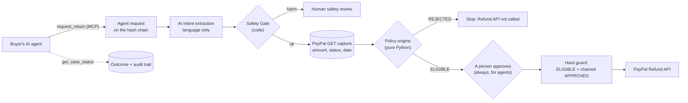

# Agent gateway: AI agents can request a return, never approve one

PayPal's own MCP server lets an AI agent issue refunds directly. That is the right tool for a merchant's own agent,
and the wrong one for an agent that acts for a **buyer**: nothing between the agent and the Refund API checks the
merchant's return policy, notices a prompt injection, or asks a person.

TradeOS exposes a second door for that kind of agent. It is an MCP server at `/mcp` with three tools, and it has no
approve, decline or refund tool. A request from an agent runs through the same loop as a dashboard case. Every
agent-originated case then waits for a person at the merchant, even with `AUTO_ENABLED` on.

## What an agent can and cannot do

| Tool | What it does | Moves money? |
|---|---|---|
| `place_demo_order` | Sandbox demo only: buys the demo sneakers (49.99 USD) with a PayPal Sandbox test card, so the buyer has an order to return. `purchased_days_ago` seeds an older purchase date (labelled demo data). Off with `TRADEOS_AGENT_DEMO_ORDERS=0`. | A Sandbox capture, like the dashboard's Run buttons |
| `request_return` | Asks for a return (refund) or a size exchange on that order, with the buyer's words. One request per order. | No |
| `get_case_status` | Reads the outcome: policy decision and reasons, who approved, PayPal refund id and status, Refund API call count, audit-chain verification, and a plain-words `next_step` that never calls a refund done before PayPal reports COMPLETED. While a payment waits for the buyer, `buyer_approval_url` is the PayPal link to hand them. | No |
| approve / decline / refund | **Not offered.** Only a person on the dashboard (or the merchant's own autonomy policy, for non-agent cases) approves. | — |



## What is guaranteed, and where it is tested

All of the following are asserted in [`tests/test_agent_gateway.py`](../tests/test_agent_gateway.py). The suite
was also mutation-checked: removing each defence below makes at least one test fail.

| Property | How |
|---|---|
| No tool can approve, decline or refund | The server registers exactly three tools; the test asserts the set and that no name contains approve, decline, refund or capture. |
| Every agent request waits for a person | `autonomy.decide_detailed(..., agent_originated=True)` returns HUMAN before any limit is read. Asserted with `AUTO_ENABLED=1` and the amount inside the limit, for refunds and exchanges. |
| The agent cannot set the amount | The refund is PayPal's whole capture (no `amount` sent), and the policy reads amount, currency, status and date from `GET /v2/payments/captures/{id}`. A message claiming "500 USD" changes nothing. |
| Prompt injection, a late order and a safety report end with Refund API calls = 0 | Same policy, injection heuristic and Safety Gate as the dashboard; `approve()` is refused afterwards too. |
| No re-rolls | Only an `AGENT_ORDERED` case is evaluated. A second `request_return` on the same order returns the first outcome without another LLM call or PayPal read. |
| An agent sees only gateway orders | Any other id, including a real dashboard case, is "not found". Archived orders too. |
| Nothing is truncated | A message over the 500-character limit is refused, as on the dashboard. Cutting it would hide whatever came after the cut (a fire, an injury) from the Safety Gate. |
| Failures are reported as failures | An order PayPal could not complete is a tool error, not an order. A request on an order with no capture yet says the buyer must approve the payment first. After the buyer approves, the order waits for the agent's request; it is never evaluated on placeholder text. |
| Who asked is on the hash chain | `audit:agent` entries record the agent name, the buyer it acts for, the message and `agent_can_approve: false`. The chain verifies. |

## Accountability: what the audit chain can prove

Each agent case answers four questions from its own hash chain, which `get_case_status` and the evidence export
both expose.

| Question | Recorded as | Proven? |
|---|---|---|
| Which agent asked? | `credential`: the name of the token the gateway verified (`TRADEOS_MCP_AGENTS`), next to the agent's self-declared `agent` name | **Yes** when per-agent tokens are configured. With the shared `TRADEOS_MCP_TOKEN` the caller is authenticated but not individually named. With an open gateway (the hosted demo) the chain records `identity_verified: false`, and the dashboard says "Name self-declared, not verified". |
| For which buyer? | `on_behalf_of` | **No.** It is the agent's claim. Proving it needs buyer-signed mandates (AP2-style), not built. |
| What did it ask? | The exact message after cleaning (control and invisible characters removed, never truncated) | Yes: hashed into the chain. |
| Who approved the money? | `approval_source: human` plus the approval entry | **Partly.** It proves a person used the merchant dashboard, not which person: the demo dashboard has no logins. |

Only the gateway can set `credential`, after checking a token with a constant-time compare against every
configured token. Headers and tool arguments cannot set it (tested). An agent can also keep the `audit_trail.head`
hash from `get_case_status` as its own receipt. Because that copy lives outside TradeOS's database, a later rewrite
of the case's chain would no longer match it.

The hosted demo keeps SQLite under `/tmp`, so a restart or deploy wipes every chain, and no head list is retained
off-site (the deploy-verify secret is not set). Accountability that has to survive a deploy needs a persistent
database and external head retention.

## Connecting an agent

Any MCP client that speaks Streamable HTTP can point at `https://<your-host>/mcp`. The endpoint is stateless and
answers JSON, so it works behind Render's proxy without sticky sessions.

For a client that launches a local process instead, the same tools are served over stdio against your local
database and `.env`:

```json
{
  "mcpServers": {
    "tradeos": {
      "command": "python",
      "args": ["-m", "app.agent_gateway"],
      "cwd": "/path/to/tradeos"
    }
  }
}
```

## Demo

[`scripts/agent_demo.py`](../scripts/agent_demo.py) plays the buyer's agent against a running instance over HTTP
and asserts four scenes: an honest return that waits for a person, a prompt injection, a late order, and a re-roll.
It prints the dashboard link where the merchant approves scene 1.

```bash
python scripts/agent_demo.py https://<your-host>                     # or http://localhost:8000
python scripts/agent_demo.py https://<your-host> --wait-approval 120 # then approve on the dashboard
```

Each scene creates a Sandbox order and runs the LLM, so the script shares the server's per-address run limit
(5 per minute by default). It waits and retries on HTTP 429, so a full run takes about a minute.

## Security

| Layer | Setting | Behaviour |
|---|---|---|
| Bearer token | `TRADEOS_MCP_AGENTS`, `TRADEOS_MCP_TOKEN` | When either is set, every `/mcp` request needs `Authorization: Bearer <token>` matching one of them (constant-time compare against all), else 401. A per-agent token becomes the case's verified credential. |
| Host pinning | `PUBLIC_BASE_URL`, `TRADEOS_MCP_ALLOWED_HOSTS` | Requests whose `Host` is not the public host, localhost or a listed extra get 421. This stops DNS rebinding, which the app's Origin check cannot see because Origin and Host then agree. |
| Cross-site browsers | (always) | A browser POST with a foreign `Origin` is refused with 403 by the app's CSRF check. |
| Rate limit | `RATE_LIMIT_PER_MINUTE` and friends | `place_demo_order` and `request_return` draw on the same per-address budget as the dashboard's Run buttons (one bucket, not two), including inside JSON-RPC batches. Reads are not throttled. |
| Body cap | (fixed) | Bodies over 64 KB get 413 before the SDK sees them. |
| Off switch | `TRADEOS_MCP=0` | No `/mcp` route at all. |

## Limits (stated plainly)

- **Identity is only as strong as the configuration.** Without `TRADEOS_MCP_AGENTS` the agent's name is a label.
  `on_behalf_of` is always the agent's claim, and the dashboard approver is never a named person (see
  Accountability above).
- **One request per order cuts both ways.** It stops an agent from rephrasing until it gets a yes, and it also
  means a buyer cannot correct a first request through the agent. Follow-ups go to a person at the merchant.
- **Demo orders are Sandbox only.** In production, orders would come from the merchant's store, and the gateway
  would look up an order the buyer actually placed instead of offering `place_demo_order`.
- **One merchant, open demo.** Like the rest of TradeOS, there are no merchant accounts yet, and on Render the
  SQLite database is wiped on every restart or deploy.
- **The contrast with PayPal's own MCP refund tool is described, not measured here.** No test in this repository
  calls PayPal's MCP server.
